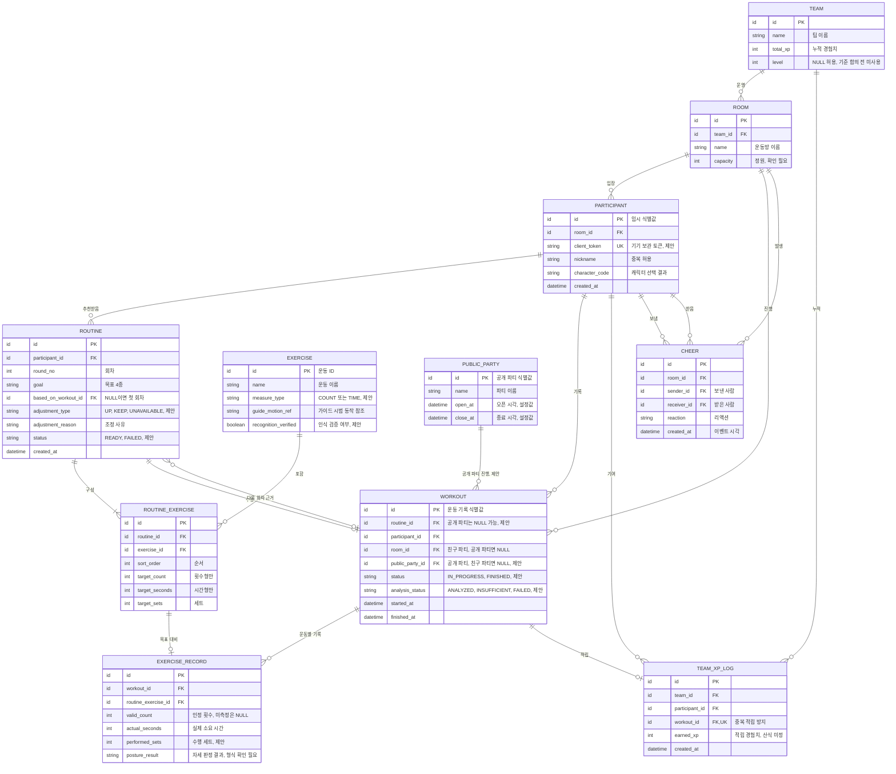

# FITMATE ERD

> 스택 중립 초안. 타입은 논리 타입이며 DB가 정해지면 바꾼다. 기능명세서의 `데이터` 항목을 근거로 했고, **제안**으로 표시한 것은 PM 문서에 없는 설계 판단이다.

## 테이블 근거

| 테이블 | 근거 기능 | 비고 |
|---|---|---|
| `TEAM` | 9.1 | 팀 정의가 미정이라 한 운동방에 팀 하나를 임시로 가정한다 |
| `ROOM` | 2.1, 4.1 | 시연에서는 미리 넣어 둔 한 행을 쓴다 |
| `PARTICIPANT` | 2.2 | 닉네임은 유니크가 아니다. 같은 이름이어도 기록을 혼동하지 않아야 한다 |
| `EXERCISE` | 1.2, 3.2, 5.1 | 운동 목록이 미정이라 행은 나중에 넣는다 |
| `ROUTINE` | 1.2, 8.2 | 첫 회차와 2회차를 같은 구조로 저장한다 |
| `ROUTINE_EXERCISE` | 1.2, 1.3 | 횟수형과 시간형 중 하나만 채운다 |
| `WORKOUT` | 7.1, 8.1, 8.3, 9.1, 10.1 | 한 회차 수행 단위. 이 ID로 경험치 중복을 막는다. 성장 기록(8.3)은 별도 테이블 없이 이 테이블과 `EXERCISE_RECORD`, `ROUTINE`을 참가자 기준으로 모아 조회한다 |
| `EXERCISE_RECORD` | 3.2, 8.1 | 운동별 수행 기록. 플랭크는 `actual_seconds`로 기록한다 |
| `TEAM_XP_LOG` | 9.1 | `workout_id` 유니크로 중복 적립을 DB에서 막는다 |
| `CHEER` | 6.1 | 응원 이벤트 기록 |
| `PUBLIC_PARTY` | 2.4, 10.1 | **제안.** 공개 선셋 파티(P1). 오픈·종료 시각은 설정값이며 정원이 없다. 친구 파티 `ROOM`과 섞지 않는다 |

## DB에 저장하지 않는 값 (제안)

아래는 자주 바뀌는 실시간 값이라 실시간 계층에서만 다루고, 확정된 결과만 DB에 남긴다.

| 값 | 근거 기능 | 처리 |
|---|---|---|
| 동작 정보 (관절 좌표) | 5.2 | 같은 방 참가자에게 전달만 한다 |
| 현재 운동, 진행 상태 | 4.1, 4.2 | 방의 참가자 상태로 유지한다 |
| 연결 상태 | 4.4 | 끊기면 연결 불안정으로 표시한다 |
| 카메라 원본 영상 | 3.1 | 저장 대상에서 제외한다. 처리 위치는 미정 |

## ERD를 바꿀 수 있는 결정

| 결정 | 결정권 | 바뀌는 곳 |
|---|---|---|
| 운동방과 팀의 관계 | 팀 합의 | `TEAM`과 `ROOM` 관계 |
| 인원수와 정원 | PM | `ROOM.capacity` |
| 5일 테스트의 임시 식별 유지 방식 | PM, 백엔드 | `PARTICIPANT.client_token` |
| 자세 결과 형식 (점수, 등급, 교정 횟수) | PM, AI | `EXERCISE_RECORD.posture_result` |
| 경험치 산식과 레벨 구간 | 팀 합의 | `TEAM.level`, `TEAM_XP_LOG.earned_xp` |
| 경험치 적립 단위 (회차, 운동별) | 팀 합의 | `TEAM_XP_LOG.workout_id` |
| 난이도, 주요 부위, 예상 시간 표시 여부 | PM | `EXERCISE`, `ROUTINE`에 컬럼 추가 |
| 수행 부족 시 유지 또는 하향 | PM, AI | `ROUTINE.adjustment_type` |
| 응원 기록의 저장 기간 | PM | `CHEER` 유지 여부 |
| 공개 파티 운영 시각·요일, 팀 경험치 적립 여부 | PM | `PUBLIC_PARTY`, `TEAM_XP_LOG` 적용 범위 |
| 공개 파티 에어로빅의 판정 방식(횟수형·시간형) | PM, AI | `EXERCISE.measure_type`, `EXERCISE_RECORD` |
| 회차마다 목표를 다시 고를 수 있는지 | PM | `ROUTINE.goal` |
